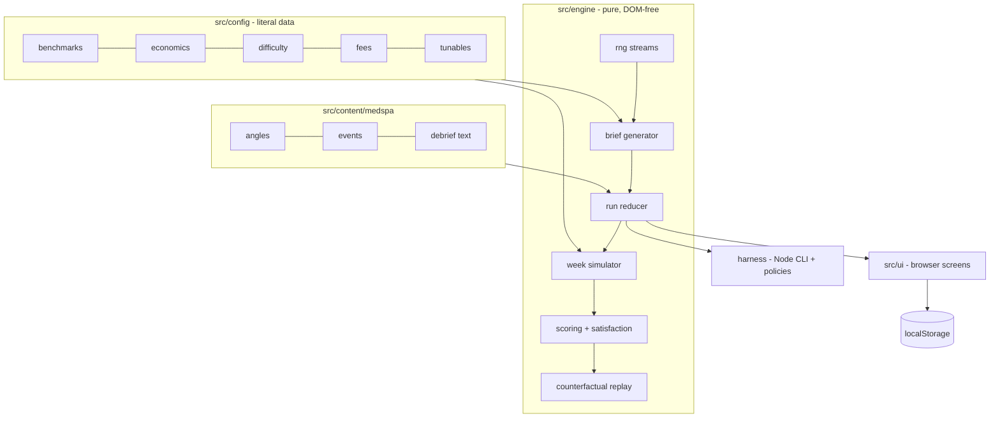
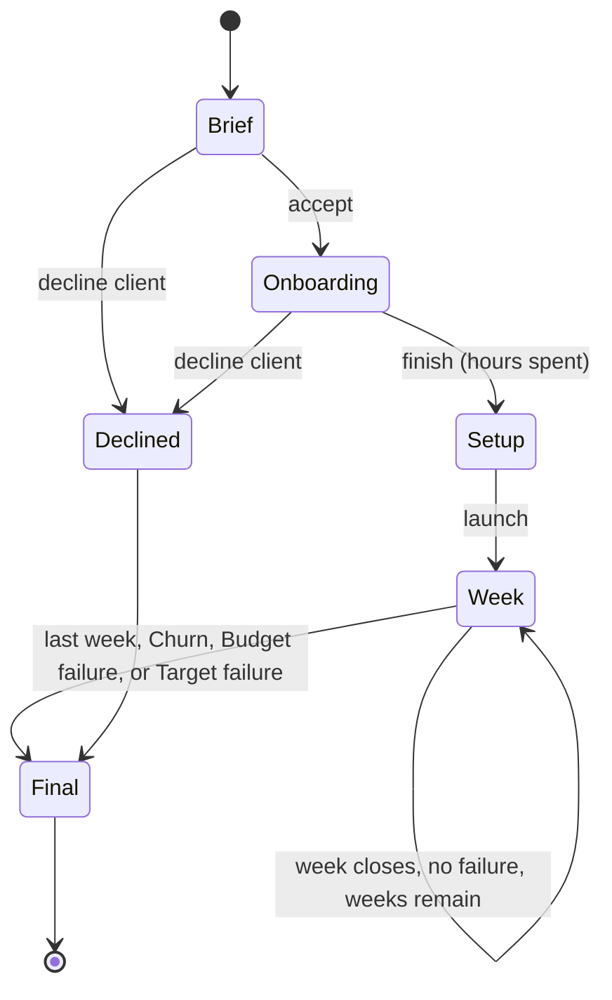

# Agency Builder Sim M0 Engine and M1 Med Spa Slice - Plan

**Target repo:** `WezzyIndy/agency-builder-sim` (new, public). Repo root = the `Projects/Agency Builder Sim/` folder, which becomes its own git repo nested inside (and untracked by) the AI Home monorepo, the same way `Projects/Coparenting Event Tracker/` is handled. All paths below are relative to that root.

---

## Goal Capsule

- **Objective:** Build milestone M0 (headless simulation engine plus calibration harness) and milestone M1 (playable med spa, L1 Meta, Ads Manager Only slice) from `agency-builder-sim-spec-v4.md`, deployed to GitHub Pages.
- **Authority:** owner decisions in this plan > `agency-builder-sim-spec-v4.md` > this plan's Assumptions > implementer judgment.
- **Execution profile:** engine first, harness-gated. No UI work (U11) starts until the harness passes for med spa (U10).
- **Stop conditions:** stop after M1 is deployed and verified, for an owner playtest. Do not start M2 (pitch), M3 (Search), or other businesses' content. Surface a blocker instead of guessing if calibration cannot meet a harness criterion without changing a [STATED] spec value.
- **Tail ownership:** the executor commits on the new repo's `main`, creates the GitHub repo, and enables Pages. No PR flow: single-owner repo.

---

## Product Contract

### Summary

Ship a pure-JavaScript simulation engine that generates client briefs, simulates weekly Meta campaign results from benchmark ranges, and scores the player, verified by a headless harness that plays thousands of seeded campaigns. On top of it, ship one complete playable vertical slice: a med spa client in Ads Manager Only mode, from brief through onboarding, 8 weekly rounds, and a final debrief with a counterfactual replay, playable on a phone.

### Problem Frame

The owner wants to build skill and confidence for running an SMB paid-social agency. The spec says content is the real cost, so it prescribes one calibrated vertical slice before expanding. If the engine's numbers are wrong, every later piece of content teaches the wrong lesson. The harness is therefore the M0 exit gate, and the slice exists to let the owner playtest the core loop before pitch scripts and other businesses are written.

### Requirements

**Engine and data (M0)**
- R1. Store benchmark anchors (Sections 18.1–18.6) and business economics (5.1) for all 6 v1 businesses as min/typical/max, and derive CVR, CPC, and CPM at runtime per the 9.1 anchoring rules.
- R2. Generate procedural briefs for all 6 businesses per 5.1–5.4, including the after-fee Business target, difficulty class and source, complications, and red flags.
- R3. Simulate a Meta campaign week (9.2–9.8): funnel, modifiers with the [0.4, 2.5] clamp, continuous learning state, tracking defects (true vs reported), lead quality, creative fatigue, seasonality, and realism-scaled variance.
- R4. Every run is reproducible from its seed and decision log.
- R5. Enforce the Meta rules in 7.3–7.5 for the options the slice exposes, plus the med spa policy layer in 5.5 (Meta portion).
- R6. Compute Satisfaction (13.3), failure states (13.5), the Ad mode score (13.2), the best-practice rubric (13.4, Onboarding + Meta + Relationship checks), client profit after fee and ads-only (5.3), and agency P&L (12).

**Harness (M0 exit)**
- R7. A headless harness runs N seeded simulations per business × realism × policy (best-practice, naive, random) and checks the Section 16 pass criteria that apply to M0 (1–6, 8, 9, 11 Meta portion), failing loudly when a criterion misses.

**Med spa slice (M1)**
- R8. Ads Manager Only mode: a generated med spa brief at L1, with a pre-set client expectation and the default fee ($1,000 + 10% of spend).
- R9. Round 0 onboarding with a 6-hour budget: audit, fix, or disclose hidden defects, including the med spa data-source restriction and the neutral-naming step.
- R10. Campaign setup and 8 weekly rounds: Advantage+ or manual, objective, conversion location, performance goal and event, audience option, budget split, angles, weekly edits, client update choice, and client events.
- R11. A round debrief each week (biggest driver, stronger move) and a final debrief with counterfactual replay, client profit, agency P&L, true vs reported gap, difficulty class and source, rubric pass/fail with reasons, and the honest-limit statement.
- R12. Autosave after every round to localStorage and resume an in-progress run; record scores, including Sandbox-flag and realism fields, for later unlock math.
- R13. Playable on a phone; one weekly round ≤ 3 minutes and a full run ≤ 30 minutes; deployed to GitHub Pages.

### Acceptance Examples

- AE1. **Covers R4.** Given seed S and a decision log, when the run is replayed, then every week's true and reported results match the original exactly.
- AE2. **Covers R4, R11.** Given a finished run where the player picked the Traffic objective, when the counterfactual replaces it with Leads, then only decision-dependent outcomes change; event draws and the client's hidden fields stay identical.
- AE3. **Covers R5.** Given a med spa ad set using a "personal attribute" angle, when the week simulates, then it is disapproved with 80% probability; a disapproved ad set delivers zero results that week and Relationship drops by 5.
- AE4. **Covers R9.** Given a med spa brief whose data source is partially restricted, when the player opens campaign setup, then the website Lead and Schedule events are greyed out with "restricted by data source category" and cannot be selected.
- AE5. **Covers R6.** Given 2 consecutive weeks with Satisfaction under 40, when the second week closes, then the run ends in Churn and goes to the final debrief.
- AE6. **Covers R12.** Given a run saved after week 3, when the page reloads, then the player can resume at week 4 with the same state.

### Scope Boundaries

- Only med spa gets playable content (angles, events, debrief text). The other 5 businesses get data and brief generation only, enough for harness criteria 8 and 9.
- Meta only. No Google Search funnel, keyword bank, or search terms report.
- No pitch mode. Full Run, Pitch Only, and Sandbox appear in the menu as "coming soon."
- No Firebase, no sign-in, no score-history views, no explainer library, no About screen. The honest-limit statement appears in the final debrief instead.
- No HVAC lead-pool split in the funnel; the generator still draws the HVAC service share.

#### Deferred to Follow-Up Work
- Harness criterion 7 (sandbag test) needs pitch mode: M2.
- Harness criterion 10 (unviable briefs can't be won) has no economically unviable med spa briefs at L1 (natural mix 100/0/0), so it can't be checked on the slice: M4, on cleaning and apparel.
- Harness criterion 11 Search portion (drug-name keywords): M3.

### Success Criteria

- The harness passes every applicable criterion for med spa at L1 on Meta.
- The difficulty-mix and generator-stall criteria pass for all 6 businesses.
- The owner can play a full med spa run on a phone from the GitHub Pages URL.

---

## Planning Contract

### Key Technical Decisions

- KTD1. **Pure engine, thin UI.** All simulation, scoring, and content lookup lives in DOM-free modules under `src/engine/` and `src/config/`. The browser UI and the Node harness import the same modules. This lets the harness test the real game, not a copy.
- KTD2. **Config as ES modules, not `.json` files.** Spec Section 17 says "JSON"; the data stays JSON-shaped but is exported from `.js` modules. Browser JSON imports need import attributes or async `fetch`, which complicates the shared Node/browser path for no gain. Data files hold only literal data, no logic.
- KTD3. **Decisions are data; a run is a reducer.** A run is a serializable state object. Every player action is a plain decision object appended to a decision log and applied by a pure step function. The UI, the harness policies, autosave, and counterfactual replay all go through this one API.
- KTD4. **Named RNG streams derived from the run seed.** Use a small seedable PRNG (e.g. mulberry32) with sub-seeds hashed from `(runSeed, purpose, week, adSetIndex)`. Brief generation, event draws, policy-disapproval rolls, and funnel noise each use their own stream. A changed decision in a counterfactual then shifts only the outcomes it should, which AE2 requires.
- KTD5. **Learning penalty normalized to the benchmark.** Published benchmark medians already reflect mostly learning-limited small accounts. The learning cost multiplier is divided by its value at a reference progress: the expected progress of one ad set at the typical L1 budget for that category. Best practice at a typical budget then lands near the typical benchmark cost. Over-splitting, edits, and low-frequency events still push cost up from there (owner-approved default (a)).
- KTD6. **Harness pass bands.** Where the spec gives only cross-source medians (e.g. Beauty CPL $42.10–$51.42), criterion 1 uses a band of 0.7×–1.4× the typical value, combined with any wider sourced range. Missing min/max anchors default to ±30% of typical (owner-approved defaults (a) and (d)).
- KTD7. **Two-speed harness.** The full run (N=1,000 per cell) is a CLI script with a report table and a nonzero exit on failure. A reduced-N smoke version runs inside `node --test`, so the regular test suite catches calibration regressions quickly.
- KTD8. **Counterfactual by bounded search.** At run end, each failed rubric check that maps to a decision proposes a recommended replacement. Replay the run once per candidate (cap 6) on the same seed and decision log with that one substitution, and report the candidate with the largest gain in true result.
- KTD9. **Static hosting, no build.** Plain `index.html` with `<script type="module">`, served from the repo root on GitHub Pages with `.nojekyll`, matching State Hoops and Wheelchair Basketball. A minimal `package.json` (`"type": "module"`, no dependencies) only adds `test` and `harness` scripts.
- KTD10. **localStorage behind a guard.** Every read and write is wrapped in try/catch. When storage is unavailable, the game still plays; it just can't resume.

### Assumptions

- In Ads Manager Only mode there is no pitch, so red flags can't be discovered by questions. The brief screen therefore shows short "client intake notes" that hint at any red flag. The player may decline the client on the brief screen or at the end of onboarding, and the decline is scored with the 11.5 walk-away rules. Undeclined red flags fire as forced events (10.2).
- The Ads Manager Only client expectation is drawn between the Business target and the benchmark typical cost, with roughly 1 in 4 briefs over-optimistic (beating the benchmark's best edge). Each expectation either includes a 2-week ramp or none, drawn per brief (owner-approved default (c)).
- 12-month customer value is clamped to ≥ first job value after drawing (owner-approved default (b)).
- The realism level is picked on the brief screen (default 3) and locked for the run.
- In week 1, Satisfaction's "trailing 2 weeks" uses week 1 alone.
- An objective change is offered as "relaunch as a new campaign." It resets learning to week 1 and counts as a significant edit.
- Agency hours per week [DESIGN]: 1.5 h base + 0.5 h per ad set + 0.5 h per significant edit + 0.5 h per event response. Onboarding hours spent count toward the agency P&L.
- The med spa event deck has 8–12 events, written by the implementer and reviewed by the owner during the playtest, not before.

### High-Level Technical Design

Module layout and data flow:



Run lifecycle (one state machine shared by UI and harness):



Weekly simulation pipeline, per ad set (directional):

```text
base anchors (category min/typical/max, realism-scaled draw)
  -> modifiers: audience option, angle resonance, objective/goal fit, Advantage+,
     conversion location, landing page, learning (normalized), fatigue, seasonality
  -> clamp product to [0.4, 2.5]   (wrong objective and disapproval bypass the clamp)
  -> funnel: clicks -> true conversions -> reported = true * tracking_factor
  -> lead quality: jobs = true leads * close rate * source mult * speed-to-lead mult
  -> revenue, client profit (after fee and ads-only), platform CPA vs true cost per result
  -> satisfaction, rubric facts, failure checks
```

### Output Structure

```text
index.html
style.css
package.json
README.md
.nojekyll
agency-builder-sim-spec-v4.md
docs/plans/
src/
  config/      benchmarks.js economics.js difficulty.js fees.js tunables.js
  content/medspa/  angles.js events.js onboarding.js debrief.js
  engine/      rng.js math.js benchmarks.js brief.js run.js metaRules.js policy.js
               week.js satisfaction.js scoring.js counterfactual.js debrief.js
  ui/          main.js screens/*.js storage.js format.js
harness/       run.js policies.js criteria.js report.js
tests/         *.test.js
```

---

## Implementation Units

| U-ID | Title | Key files | Depends on |
|---|---|---|---|
| U1 | Repo scaffold and GitHub repo | `package.json`, `index.html`, `README.md` | none |
| U2 | Seeded RNG and math helpers | `src/engine/rng.js`, `src/engine/math.js` | U1 |
| U3 | Config data for 6 businesses | `src/config/*.js`, `src/engine/benchmarks.js` | U2 |
| U4 | Brief generator and client economics | `src/engine/brief.js` | U3 |
| U5 | Med spa content | `src/content/medspa/*.js` | U3 |
| U6 | Week simulator | `src/engine/week.js` | U4, U5 |
| U7 | Run reducer, Meta rules, policy layer, events | `src/engine/run.js`, `metaRules.js`, `policy.js` | U6 |
| U8 | Satisfaction, failure, scoring, P&L | `src/engine/satisfaction.js`, `scoring.js` | U7 |
| U9 | Counterfactual replay and debrief data | `src/engine/counterfactual.js` | U8 |
| U10 | Calibration harness (M0 exit) | `harness/*.js` | U8 |
| U11 | Browser UI for the med spa slice | `src/ui/**`, `index.html`, `style.css` | U9, U10 |
| U12 | Deploy and M1 acceptance | Pages settings, `README.md` | U11 |

### U1. Repo scaffold and GitHub repo

- **Goal:** Turn the project folder into its own public repo with a static-site skeleton and test scripts.
- **Requirements:** R13
- **Dependencies:** none
- **Files:** `package.json`, `index.html`, `style.css`, `.nojekyll`, `.gitignore`, `README.md`, `tests/smoke.test.js`
- **Approach:** `git init` in the folder, then create `WezzyIndy/agency-builder-sim` as public. The `package.json` has `"type": "module"`, no dependencies, and `test` and `harness` scripts. The test glob uses the quoted `"tests/**/*.test.js"` form, because the plain directory form fails on Windows. The README covers serving locally over http (ES modules don't load from `file://`) and running the tests and harness. Keep the spec file at the repo root.
- **Patterns to follow:** `Projects/Wheelchair Basketball/README.md` and its `tests/` layout.
- **Test scenarios:** `Test expectation: none -- scaffolding; one smoke test confirms the runner discovers files.`
- **Verification:** `npm test` runs and passes the smoke test; the remote repo exists and `main` is pushed.

### U2. Seeded RNG and math helpers

- **Goal:** Deterministic randomness with independent named streams, plus the numeric helpers every module needs.
- **Requirements:** R4
- **Dependencies:** U1
- **Files:** `src/engine/rng.js`, `src/engine/math.js`, `tests/rng.test.js`, `tests/math.test.js`
- **Approach:** A seedable PRNG, string hashing for sub-seeds (KTD4), and helpers for uniform, triangular(low, typical, high), weighted pick, and normal-ish noise. In `math.js`: safe divide (returns null for "no results"), clamp, and rounding helpers.
- **Test scenarios:**
  - The same seed and stream name produce an identical sequence; a different stream name produces a different sequence.
  - Drawing extra values from stream "events" does not change the next value from stream "funnel".
  - Triangular(10, 20, 40) over 20,000 draws stays within [10, 40] with mean ≈ 23.3 (±0.5).
  - Triangular with low = typical = high returns that value.
  - Safe divide by 0 returns null, never Infinity or NaN.
- **Verification:** All tests pass; no module outside `rng.js` calls `Math.random`.

### U3. Config data for 6 businesses

- **Goal:** Encode the spec's sourced and design numbers as literal data, plus runtime derivation of the non-anchor metrics.
- **Requirements:** R1
- **Dependencies:** U2
- **Files:** `src/config/benchmarks.js`, `src/config/economics.js`, `src/config/difficulty.js`, `src/config/fees.js`, `src/config/tunables.js`, `src/engine/benchmarks.js`, `tests/benchmarks.test.js`
- **Approach:** `benchmarks.js` holds Meta lead, Meta ecomm, and Search anchors per category from 18.1–18.4. It also holds the HVAC 2.5× replacement multiplier (CPL only), the roofing Search premium, and each business-to-category mapping from 5.2. Missing min/max fall back to ±30% (KTD6). `economics.js` holds the 5.1 table and the HVAC service-share distribution. `difficulty.js` holds the target mixes, complications per business, and red flags (5.4). `fees.js` holds the default fee, the $1,000 minimum, and the tolerance ranges by spend (12). `tunables.js` holds every 19.4 value with its starting value. `src/engine/benchmarks.js` derives CVR, CPC, and CPM per the 9.1 table.
- **Test scenarios:**
  - Derived Meta Home CVR = 5.08%, Beauty CVR = 5.83%, and Home display CPM = $46.65 (to 2 decimals).
  - Derived Lifestyle & Boutique CVR = 1.74% and CPC = $0.54; Apparel CVR = 1.47%.
  - Derived Search Home CVR = 9.16%, HVAC replacement 3.66%, Personal Services 13.13%.
  - HVAC replacement Meta CPL typical = $107, with CPC and CTR unchanged from Home.
  - Every business in the catalog maps to a category that exists in the benchmarks.
  - Every min ≤ typical ≤ max, for every anchor.
- **Verification:** The 18.6 derived-values table is reproduced by tests.

### U4. Brief generator and client economics

- **Goal:** Generate a hidden-field brief per 5.1–5.4 for any of the 6 businesses at L1 or L2, with the after-fee Business target and difficulty classification.
- **Requirements:** R2, R8
- **Dependencies:** U3
- **Files:** `src/engine/brief.js`, `tests/brief.test.js`
- **Approach:** Follow the 5.4 generation order: draw the target class, then economics, budget, and fee. Compute value per customer, breakeven, and the target ad CPL/CPA with `k` and `ad_share`. Resample up to 200 draws when the natural share of the target class is ≥ 2%. Otherwise apply levers: 2 complications for hard, 1 red flag for unviable. For L2, classify on the better channel. Precompute the natural mixes once per business and level (a generator-internal Monte Carlo replacing `mix_v4.py`) and cache them. Also draw speed-to-lead, seasonality, campaign length (default 8), hidden tracking defects, fee tolerance, and the Ads Manager Only client expectation and ramp (Assumptions). Clamp 12-month value ≥ first job value.
- **Test scenarios:**
  - With typical values and k = 0.65 at L1, med spa breakeven CPL = $306 and target ad CPL ≈ $124 (5.3 table); apparel L1 target CPA ≈ $20.72.
  - Default fee at $2,000 spend = $1,200; ad share = 0.625.
  - Ratio exactly 0.9 classifies achievable; 0.6 classifies hard; 0.5999 classifies unviable.
  - Over 1,000 briefs per business at L1, each class is within ±5 points of the target mix (criterion 8 smoke).
  - No brief takes more than 200 economic draws, and the cap path falls back to levers (criterion 9).
  - A med spa "hard" brief at L1 always carries exactly 2 complications, all from the med spa list.
  - A red-flag brief has achievable economics and exactly 1 red flag.
  - 12-month value is never below first job value across 10,000 cleaning and HVAC-service briefs.
  - The same seed produces an identical brief.
- **Verification:** All tests pass; the generator handles all 6 businesses at L1 and L2.

### U5. Med spa content

- **Goal:** Write the playable med spa content the engine and UI consume.
- **Requirements:** R5, R9, R10, R11
- **Dependencies:** U3
- **Files:** `src/content/medspa/angles.js`, `src/content/medspa/events.js`, `src/content/medspa/onboarding.js`, `src/content/medspa/debrief.js`, `tests/content.test.js`
- **Approach:**
  - **Angles:** 5 angles with copy, hidden resonance per audience option, and a policy flag. At least one angle is compliant and strong, one is a prohibited-flag trap, and one uses before/after.
  - **Events:** 8–12 events with 2–3 scored responses and debrief explanations. Include "Meta rejected our ad again," the L1 fee-ratio event, "pause everything," "these leads are junk" (auto-fire rule), a 30% budget cut, a competitor discount, and one forced event per red flag.
  - **Onboarding:** defect checks with hour costs and fix/disclose text, the data-source restriction defect, and the neutral-naming step.
  - **Debrief:** driver explanations and the compliant rewrite for each policy flag.
- **Test scenarios:**
  - Every angle has a resonance value for every audience option and a valid policy flag.
  - Every event has 2–3 responses, each with a score and an explanation.
  - Each of the 5 red flags has a forced event.
  - Every prohibited flag has a compliant-rewrite text.
- **Verification:** Content schema tests pass; the copy follows 5.5 (no inferiority, no personal attributes, no timeframe promises in compliant variants).

### U6. Week simulator

- **Goal:** Simulate one week for all ad sets of a campaign and return true and reported results.
- **Requirements:** R3
- **Dependencies:** U4, U5
- **Files:** `src/engine/week.js`, `tests/week.test.js`
- **Approach:** Implement the 9.2 funnel for Meta leads and Meta ecomm, plus the 9.3 lead-quality multipliers. Apply the 9.4 tracking factors, where a corrupted signal degrades CVR over the following weeks. Learning (9.5) is normalized per KTD5. Modifiers and the clamp follow 9.6, fatigue follows 9.7, and realism scales variance and non-benchmark modifier weight (9.8). Ecomm runs through the same code path for harness use, even though apparel content is M4. Draw noise from the "funnel" stream keyed by week and ad set.
- **Test scenarios:**
  - Zero spend, or zero true conversions, yields "no results" (null), never NaN or Infinity (criterion 6).
  - A double-fire defect makes reported leads > true leads; a missing purchase event makes reported purchases ≈ 0.
  - With the product of modifiers forced to 0.1, the effective multiplier is clamped to 0.4; with 5.0, to 2.5.
  - The Traffic objective for a leads goal bypasses the clamp, and true leads fall near zero.
  - One ad set at the typical L1 budget has a normalized learning multiplier ≈ 1.0. Splitting into 3 ad sets raises cost per result.
  - At realism 1, variance across 1,000 seeds is lower than at realism 5.
  - Angle CTR decays ×0.9 per week after week 3.
  - A default instant form yields a lower CPL but fewer jobs than a website form at the same spend.
  - Same inputs and seed produce identical output.
- **Verification:** Tests pass; one best-practice med spa week at typical inputs lands near $50.91 CPL.

### U7. Run reducer, Meta rules, policy layer, events

- **Goal:** The full run lifecycle as a pure reducer over decision objects, with Meta setup validation, the med spa policy layer, and the event deck.
- **Requirements:** R4, R5, R9, R10, R12
- **Dependencies:** U6
- **Files:** `src/engine/run.js`, `src/engine/metaRules.js`, `src/engine/policy.js`, `tests/run.test.js`, `tests/metaRules.test.js`, `tests/policy.test.js`
- **Approach:**
  - **Run reducer:** `createRun(seed, options)` plus `applyDecision(state, decision)` cover the states in the HTD: brief, onboarding, setup, week, and final.
  - **Meta rules (`metaRules.js`):** encode the 7.3 objective → conversion location → performance goal table for the five non-app objectives. Setup is a two-step goal + event choice. Advantage+ audience controls and suggestions follow 7.5; "further limit" turns Advantage+ audience off. Advantage+ forbids minimum age below 18. The objective locks after launch. Significant edits (budget, event, targeting, creative) reset learning.
  - **Policy (`policy.js`):** applies 5.5 using the "policy" RNG stream. Prohibited flags have an 80% disapproval chance and before/after has 10%. Any med spa ad set targeting under 18 is always disapproved.
  - **Events:** draw about one every 2 weeks from the "events" stream. Forced events fire for undeclined red flags, and the junk-leads event fires when the realized close rate is below 0.7× the brief's.
  - **Client updates:** honest, spun, or skipped, with the 10.1 Relationship effects.
  - **Persistence:** state serializes losslessly to JSON.
- **Test scenarios:**
  - Covers AE1. Replaying a run's decision log from its seed reproduces identical state.
  - Covers AE3. Over 10,000 seeds, a personal-attribute angle is disapproved 80% ± 2%; before/after 10% ± 1.5% (criterion 11 Meta).
  - Covers AE4. A restricted-data-source brief rejects Lead and Schedule website events with a "restricted by data source category" reason.
  - An instant-forms location offers only Leads and Qualified leads; Qualified leads is rejected unless CRM feedback was fixed in onboarding.
  - Changing the objective after launch is rejected; "relaunch" is accepted and resets learning.
  - Spending more than 6 onboarding hours is rejected.
  - A spun update raises Relationship now and drops it sharply the first week true outcomes surface.
  - Declining a red-flag brief ends the run as a correct walk-away; declining an achievable brief scores as a loss.
  - Serialize → parse → continue gives the same result as continuing directly.
- **Verification:** Tests pass; a scripted 8-week run completes without errors for every med spa difficulty class.

### U8. Satisfaction, failure, scoring, P&L

- **Goal:** Weekly Satisfaction, failure states, and the final score breakdown.
- **Requirements:** R6, R12
- **Dependencies:** U7
- **Files:** `src/engine/satisfaction.js`, `src/engine/scoring.js`, `tests/satisfaction.test.js`, `tests/scoring.test.js`
- **Approach:** Satisfaction follows the 13.3 formula: trailing 2-week results vs the Promise, with ×1.5 ramp relaxation only when a ramp was promised. The 13.5 failure states are Churn, Budget failure, and Target failure at the midpoint. The Ad score follows 13.2 (Performance vs Business target, rubric, mean Satisfaction). The rubric uses the 13.4 Onboarding, Meta, and Relationship checks, normalized across the checks that apply, each with a reason string. Client profit is reported after fee and ads-only, on a first-job and 12-month basis. The agency P&L shows fee revenue, hours, effective hourly rate vs the $75 target, and a keep/drop verdict. A score record carries the mode, level, business, realism, `isSandbox`, components, and timestamp.
- **Test scenarios:**
  - Covers AE5. Satisfaction of 39 then 38 triggers Churn at the end of the second week.
  - Spending more than 25% of the total budget with zero true conversions triggers Budget failure.
  - At the midpoint, a trailing true CPL 51% worse than the Business target triggers Target failure; 49% worse does not.
  - Within the promised ramp, a cost 1.4× the promise scores Results 100; with no ramp promised, it scores below 100.
  - Performance = 100 × min(1, target / actual); actual = null (no results) gives 0, not NaN. Results_week with no true results in the trailing window is also 0.
  - Rubric: 4 ad sets on a $460/week budget fails the ad-set-count check, with a reason naming the formula.
  - Agency P&L: $1,200 fee and 20 hours gives $60/h, below the $75 target.
  - A correct walk-away records Satisfaction 100 and Performance 100.
- **Verification:** Tests pass; the final state carries all fields in the spec's `final` data model.

### U9. Counterfactual replay and debrief data

- **Goal:** Produce round-debrief and final-debrief data, including the counterfactual delta.
- **Requirements:** R11
- **Dependencies:** U8
- **Files:** `src/engine/counterfactual.js`, `src/engine/debrief.js`, `tests/counterfactual.test.js`, `tests/debrief.test.js`
- **Approach:** For the round debrief, rank the week's modifier contributions to find the single biggest driver and attach the stronger-move text from content. For the counterfactual, use the KTD8 bounded search: map failed rubric checks to replacement decisions, replay each (cap 6), and pick the largest gain in true result. Report the deltas in true result, client profit, and Satisfaction. The final debrief also bundles the difficulty class and source, the true vs reported gap, the rubric, the P&L, and the honest-limit text.
- **Test scenarios:**
  - Covers AE2. A Traffic → Leads counterfactual leaves event draws and the brief identical and improves true leads.
  - A run with no failed decision checks reports "no higher-impact alternative found" rather than an empty delta.
  - The biggest driver for a week with a disapproved ad set is the policy disapproval.
  - The counterfactual replays at most 6 candidates.
- **Verification:** Tests pass; the final debrief object renders without missing fields for completed, churned, and declined runs.

### U10. Calibration harness (M0 exit)

- **Goal:** A headless harness that proves the engine teaches the right lessons, and the tuning that makes it pass for med spa.
- **Requirements:** R7
- **Dependencies:** U8
- **Files:** `harness/run.js`, `harness/policies.js`, `harness/criteria.js`, `harness/report.js`, `tests/harness.smoke.test.js`
- **Approach:**
  - **Policies:** the three Section 16 policies are written as decision generators over the run API (KTD3). Best-practice passes every applicable 13.4 check. Naive uses the Traffic objective, 4+ ad sets, weekly edits, default instant forms, and hard-limited audiences. Random makes random valid choices.
  - **Criteria:** check criteria 1–6 and 11 (Meta) for med spa L1, and 8–9 for all 6 businesses at L1 and L2, using the KTD6 bands.
  - **Output:** CLI flags for business, realism, criteria group (e.g. `--criteria mix`), and N (default 1,000). Print a per-criterion pass/fail table and exit nonzero on any fail. The smoke test runs at N ≈ 100 with loose tolerance.
  - **Tuning:** tune only [DESIGN] values in `tunables.js` until the harness passes. Record the final values and any criterion that needed the KTD5 or KTD6 defaults in the README's calibration notes.
- **Execution note:** Run the harness before tuning to record the baseline, then tune one tunable family at a time.
- **Test scenarios:**
  - The smoke harness for med spa at realism 3 completes with zero NaN/Infinity weeks (criterion 6).
  - The best-practice median CPL is within the band (criterion 1), and naive is ≥ 30% worse (criterion 2).
  - At realism 3 on achievable briefs: best-practice failure rate ≤ 10%, naive ≥ 50% (criterion 3).
  - On hard briefs, the best-practice failure rate is between 15% and 50% (criterion 4).
  - At realism 5, best-practice wins on median but loses to random in ≥ 15% of seeds (criterion 5).
  - The CLI exits nonzero when a criterion is forced to fail (e.g. a band set impossibly tight via a test-only override).
- **Verification:** `npm run harness -- --business medspa` passes every applicable criterion at N=1,000. The mix and stall criteria pass for all 6 businesses. This is the M0 exit.

### U11. Browser UI for the med spa slice

- **Goal:** The playable Ads Manager Only med spa run on phone and desktop.
- **Requirements:** R8–R13
- **Dependencies:** U9, U10
- **Files:** `index.html`, `style.css`, `src/ui/main.js`, `src/ui/storage.js`, `src/ui/format.js`, `src/ui/screens/menu.js`, `src/ui/screens/brief.js`, `src/ui/screens/onboarding.js`, `src/ui/screens/setup.js`, `src/ui/screens/week.js`, `src/ui/screens/event.js`, `src/ui/screens/roundDebrief.js`, `src/ui/screens/finalDebrief.js`, `src/ui/screens/settings.js`, `tests/storage.test.js`, `tests/screenFlow.test.js`
- **Approach:** A stylized interface, not an Ads Manager clone. Screens:
  - **Menu:** Ads Manager Only is active; Full Run, Pitch Only, and Sandbox show "coming soon"; Resume appears when a save exists.
  - **Brief:** shows the visible fields, intake notes, and expectation, plus a realism picker and accept/decline.
  - **Onboarding:** a checklist with an hours meter and fix/disclose per finding, plus naming.
  - **Setup:** stepped choices with invalid options greyed out and their reasons shown.
  - **Week:** a report showing true results vs platform-reported, edits, the client update, and any event.
  - **Debriefs:** the round debrief and the final debrief, which shows the counterfactual.
  - **Settings:** default realism and target hourly rate.

  Mobile-first layout with a single column at 375 px and tap targets ≥ 44 px. Every decision goes through the engine reducer; the UI holds no game logic. Autosave after every applied decision via the KTD10 guard, and record the score on final. Show "typical range from published benchmarks" wherever a benchmark figure appears.
- **Patterns to follow:** the `Projects/Wheelchair Basketball` screen-state test approach (`tests/screenFlow.test.js`) for testing flow logic without the DOM.
- **Test scenarios:**
  - Covers AE6. Save after week 3, then load, and the restored state equals the saved state; resume lands on week 4.
  - Storage that throws on read and write: the game starts and plays; Resume is hidden.
  - A corrupt save (invalid JSON) is discarded with a notice, not a crash.
  - Screen flow: brief → decline goes to the final debrief; brief → accept → onboarding → setup → week 1.
  - The setup screen's option list for instant forms matches the engine's allowed goals.
- **Verification:** A full run plays end to end in a desktop browser and at a 375 px viewport with no console errors.

### U12. Deploy and M1 acceptance

- **Goal:** Publish to GitHub Pages and confirm the M1 exit criteria.
- **Requirements:** R13
- **Dependencies:** U11
- **Files:** `README.md`
- **Approach:** Enable Pages from `main` / root. Verify on the live URL at phone width. Time one full run against the ≤ 30-minute target and one weekly round against ≤ 3 minutes. Re-run the full harness. Add the live URL, calibration notes, and the "what M1 does not include" list to the README.
- **Test scenarios:** `Test expectation: none -- deployment; verified by the live-site checks below.`
- **Verification:** The live URL loads over https, a full med spa run completes at phone width, the session-time targets are met (or the overage is reported), and the harness still passes.

---

## Risks

| Risk | Mitigation |
|---|---|
| Calibration can't satisfy criteria 3 and 4 together (best-practice ≤ 10% failure on achievable, 15–50% on hard) with the [STATED] failure thresholds | Tune only [DESIGN] values. If still failing, stop and report the closest result and the conflicting criteria instead of changing a [STATED] threshold. |
| The criterion 1 band is narrow for med spa | KTD5 normalization plus KTD6 bands; report the achieved median in the README. |
| Counterfactual drift makes deltas meaningless | KTD4 per-purpose streams; AE2 test guards it. |
| Content volume slips the slice | Med spa only; events capped at 12; owner reviews in the playtest rather than gating on approval. |
| A full run exceeds 30 minutes on a phone | Measure in U12; trim screens or default some choices rather than cutting weeks. |

---

## Verification Contract

| Gate | Command | When |
|---|---|---|
| Unit and smoke tests | `npm test` (runs `node --test "tests/**/*.test.js"`) | Every unit |
| Full harness, med spa | `npm run harness -- --business medspa` | U10 exit, U12 |
| Full harness, mix/stall all businesses | `npm run harness -- --criteria mix` | U10 exit |
| Local play | Serve the folder over http (`npx serve .`), play a full run at desktop and 375 px | U11, U12 |
| Live play | GitHub Pages URL at phone width | U12 |

---

## Definition of Done

- All units' verification items are met and `npm test` passes.
- The full harness passes every applicable criterion for med spa (M0 exit) and the mix/stall criteria for all 6 businesses.
- The med spa slice is live on GitHub Pages and playable end to end at phone width with no console errors.
- The README documents local run, tests, harness, calibration notes, the live URL, and the deferred harness criteria (7, 10, 11 Search).
- No `Math.random` outside `src/engine/rng.js`; no game logic in `src/ui/`.
- Abandoned or experimental code from tuning is removed; tunables hold only the final values.
- Work stops at M1 for the owner's playtest.
